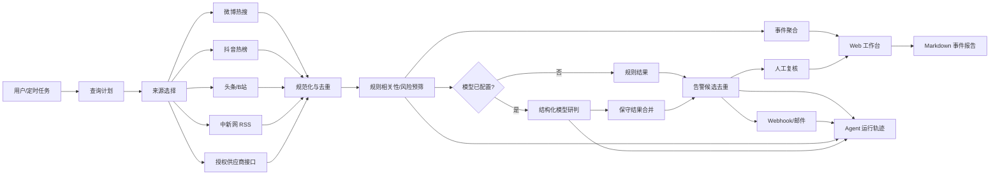

# SignalWatch 架构说明

## 1. 项目目标

SignalWatch 是一个有边界的多源舆情监测与危机预警 Agent MVP。它不承诺“全网监测”，而是在明确声明的数据源范围内：

1. 持续采集公开热榜、新闻与授权接口内容。
2. 将原始信号规范化为统一证据条目。
3. 根据监测词判断相关性，并执行风险预筛。
4. 使用标题相似度和共同监测词聚合事件。
5. 可选调用 OpenAI 兼容模型，对命中候选做结构化辅助研判。
6. 记录完整 Agent 运行轨迹。
7. 对新告警去重后通过 Webhook 或邮件送达。
8. 提供人工研判和 Markdown 事件报告。

## 2. 总体架构

## 3. Agent 运行闭环

每次扫描生成唯一的 `agent_run_id` 并依次记录：

| 步骤 | 当前实现 | 输出 |
|---|---|---|
| `plan` | 根据监测词、公开来源和授权来源生成计划 | 来源清单、研判策略、停止条件 |
| `collect` | 并发调用各来源，独立记录成功与失败 | 来源状态和条目数 |
| `rule_analysis` | 关键词命中、风险类别、风险等级 | 规则研判结果 |
| `ai_analysis` | 模型只处理命中候选，失败时回退规则 | 摘要、风险理由、核查问题 |
| `alert_delivery` | 去重后发送 Webhook/邮件 | 送达状态和错误 |
| `persist` | 写入事件、分析、告警和运行轨迹 | 可审计记录 |

核心原则：

- **数据源失败不等于没有舆情。**
- **模型失败不阻塞采集和规则告警。**
- **模型不能降低规则已经判定的风险等级。**
- **未配置告警通道时，告警候选仍保留在工作台。**
- **所有对外动作必须由人决定。**

## 4. 数据模型

| 表 | 作用 |
|---|---|
| `watch_terms` | 监测词 |
| `items` | 原始证据与首次发现时间 |
| `analyses` | 规则/AI 研判结果 |
| `source_runs` | 单个来源运行状态 |
| `reviews` | 人工研判状态 |
| `agent_runs` | 完整 Agent 执行轨迹和指标 |
| `alert_deliveries` | 告警候选、去重与送达状态 |

## 5. 告警策略

告警候选必须同时满足：

- 命中监测词
- 规则或模型风险达到中风险以上
- 同一内容未被发送过

模型超时、来源故障和没有候选都有单独状态，不会伪装成“无风险”。

## 6. 模型策略

- 接口：OpenAI 兼容 Chat Completions。
- 输入：仅发送命中监测词的候选证据，默认每次最多 20 条。
- 输出：严格解析 JSON，失败时保留规则结果。
- 合并：风险等级取规则和模型的较高值。
- 成本：候选预筛后再调用模型，避免对全部热榜内容推理。
- 安全：网页内容只作为不可信证据交给模型，不能成为系统指令。

## 7. 接入真实模型后的进一步工作

- 增加结构化输出 Schema 校验和自动重试。
- 对相同内容 Hash 缓存模型结果。
- 增加租户级 Token/成本上限。
- 建立真实人工标注集并做多模型 A/B。
- 在盲测通过后将规则阈值和模型 Prompt 一起版本化。

## 8. 扩展路径

当前 SQLite 和单进程调度适合 MVP。若扩展到多租户和生产环境：

1. SQLite → PostgreSQL。
2. 进程内调度 → Redis/Celery 或云任务队列。
3. 本地单进程 → 容器化 API 与独立 Worker。
4. 本地凭据 → OAuth/密钥管理服务。
5. 运行日志 → 结构化 Trace、指标与告警系统。
6. 单租户 → RBAC、租户隔离、数据留存和审计策略。
